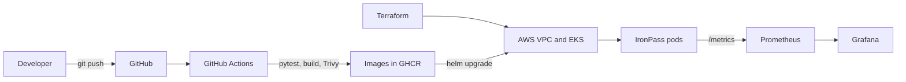

<p align="center">
  <a href="https://docs.google.com/presentation/d/REPLACE_WITH_SLIDES_ID/edit?usp=sharing"></a>
  <a href="docs/IronPass-Presentation.pdf"></a>
  &nbsp;&nbsp;
  <a href="https://www.loom.com/share/REPLACE_WITH_VIDEO_ID"></a>
</p>

# IronPass

IronPass is a small gym membership app. Staff sign members up, check them in at the front desk, and the API refuses a check-in when the member's plan has expired. This repo takes it all the way from code to a monitored Kubernetes cluster on AWS.

[](https://github.com/brixdorf/ironpass-devops-capstone/actions/workflows/ci-cd.yml)


## How it flows



## Run it in 2 minutes

You need Docker. Then:

```bash
git clone https://github.com/brixdorf/ironpass-devops-capstone.git
cd ironpass-devops-capstone
docker compose up --build
```

Open http://localhost:3000. The API docs are at http://localhost:8000/docs.
Stop it with `docker compose down` (add `-v` to wipe the database).

## The pipeline

Every push to `main` runs `.github/workflows/ci-cd.yml`.

| Stage | What happens |
| --- | --- |
| Test | `pytest` runs against SQLite. A failure stops everything. |
| Build | The React app is built, then both Docker images are built. |
| Scan | Trivy checks both images and fails on fixable HIGH or CRITICAL issues. |
| Push | Images go to GHCR, tagged with the commit SHA. |
| Deploy | Helm installs the new tag on EKS, signed in with GitHub OIDC (no AWS keys). |

## Where to find the proof

| Module | Topic | Folder or screenshot |
| --- | --- | --- |
| M1 | Application | `backend/`, `frontend/`, `docs/screenshots/01-app-running-localhost-3000.png` |
| M2 | Tests | `backend/tests/`, `docs/screenshots/02-pytest-passing.png` |
| M3 | Git and GitHub | commit history, `docs/screenshots/03-git-history.png` |
| M4 | Docker | `backend/Dockerfile`, `frontend/Dockerfile`, `docker-compose.yml`, `docs/screenshots/04-docker-compose-up.png` |
| M5 | CI/CD | `.github/workflows/`, `docs/screenshots/06-github-actions-green.png`, `docs/screenshots/07-ghcr-backend.png`, `docs/screenshots/07-ghcr-frontend.png` |
| M6 | Trivy | `docs/SECURITY.md`, `docs/screenshots/08-trivy-scan.png` |
| M7 | Terraform | `terraform/`, `docs/screenshots/09-terraform-plan.png`, `docs/screenshots/10-aws-vpc-subnets.png`, `docs/screenshots/11-aws-eks-cluster.png`, `docs/screenshots/12-terraform-apply-outputs.png` |
| M8 | Kubernetes and Helm | `helm/ironpass/`, `k8s/`, `docs/screenshots/14-kubectl-pods.png`, `docs/screenshots/16-helm-list.png`, `docs/screenshots/17-ingress-app.png`, `docs/screenshots/19-hpa-scaling.png` |
| M9 | Monitoring | `monitoring/`, `docs/screenshots/18-metrics-endpoint.png`, `docs/screenshots/20-prometheus-targets.png`, `docs/screenshots/21-grafana-dashboard.png` |
| M10 | Docs and demo | this README, `docs/DEMO.md`, `docs/IronPass-Presentation.pptx`, `docs/VIDEO_SCRIPT.md` |

The broken manifests for the troubleshooting lab are in `troubleshooting/`.

## Clean up

The cluster costs money while it is up. `scripts/teardown.sh --dry-run` shows the steps and `scripts/teardown.sh --yes` removes the Helm releases and load balancer first, then runs `terraform destroy`, then checks that nothing tagged `Project=ironpass` is left.
